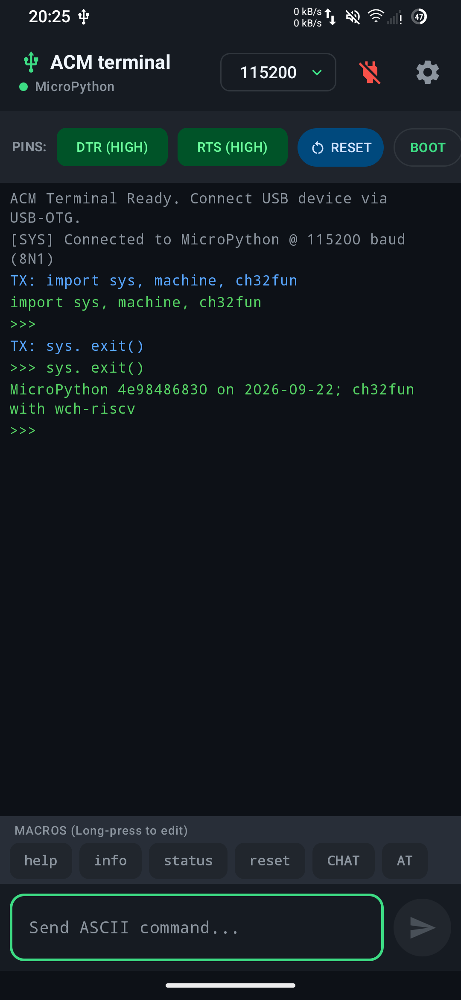

# ACM Terminal

A lightweight, dedicated Android USB-OTG serial terminal designed for debugging and interacting with USB CDC ACM microcontrollers and development boards (such as Raspberry Pi Pico, Arduino, STM32, ESP32-S2/S3, and Teensy).

  

## Overview

ACM Terminal enables direct bidirectional serial communication over USB without requiring an intermediary computer. Plug any CDC ACM class device into your Android phone or tablet via a USB-OTG adapter to start sending and receiving ASCII data in real time.

## Key Features

- **USB CDC ACM Support:** Automatic detection and connection to standard USB Communication Device Class (CDC) Abstract Control Model (ACM) peripherals.
- **Hardware Control Signals:** Dedicated hardware toggles for DTR and RTS control lines.
- **Microcontroller Bootloader & Reset:** One-tap hardware sequence triggers for system reset and entering ROM/UF2 bootloaders (e.g. Raspberry Pi Pico 1200 baud touch reset).
- **Customizable Command Macros:** Quick-action macro toolbar for frequent commands with long-press configuration and automatic newline formatting (`\r`, `\n`, or `\r\n`).
- **Flexible Serial Configuration:** Selectable baud rates from 9,600 up to 921,600 baud, configurable line endings, timestamp logging, and auto-scroll control.
- **Distraction-Free Interface:** High-contrast monospace log viewport optimized for readability in workshop and field environments.

## Getting Started

1. Connect your microcontroller to your Android device using a USB-OTG adapter or USB-C to USB-C cable.
2. Grant USB Host permission when prompted by Android.
3. Select the target baud rate in the top app bar.
4. Tap **Connect** to open the serial stream.
5. Transmit ASCII commands using the bottom input bar or configured macro buttons.

## Requirements

- Android 7.0 (API level 24) or higher
- Device with USB Host (OTG) hardware support
